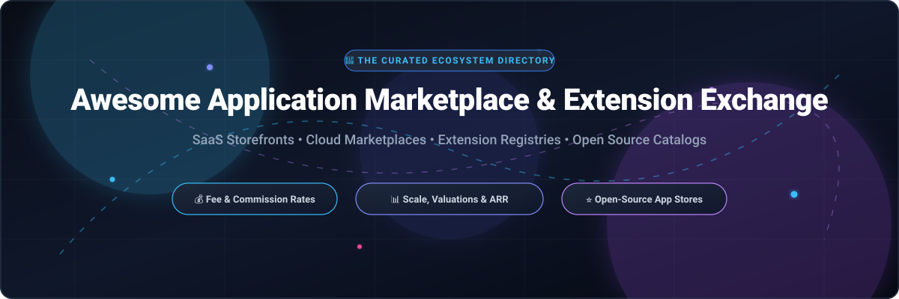

# Awesome Application Marketplace & Extension Exchange 🌐🛍️

  <strong>A curated index of major application marketplaces, extension stores, developer exchange ecosystems, and commercial platform mechanics.</strong>

  
  
  
  
  
  

  <a href="#-sector-overview--market-dynamics">Sector Overview</a> •
  <a href="#-saas-marketplaces--developer-ecosystems">SaaS Marketplaces</a> •
  <a href="#-open-source-app-stores--extension-registries">Open Source App Stores</a> •
  <a href="#-star-history">Star History</a> •
  <a href="#-support--contributing">Support</a>

---

## 📈 Sector Overview & Market Dynamics

The global cloud software and B2B application marketplace sector is estimated between **$45 billion and $85 billion** in transaction Gross Merchandise Value (GMV) by 2025–2028 (with the broader underlying enterprise cloud & SaaS software market exceeding **$390 billion to $780 billion**). The sector exhibits a distinct two-tier structure:
- 🏛️ **Infrastructure & Storefront Gateways (Highly Concentrated / Winner-Take-Most):** Dominated by hyperscale cloud marketplaces (AWS, Google Cloud, Microsoft Azure) and category leaders (Salesforce, Shopify, Atlassian), driven by enterprise cloud commitments (MACCs/EDPs) and massive unified user footprints.
- 🧩 **Independent ISVs & Niche Software Catalogs (Moderately to Highly Fragmented):** Comprising tens of thousands of independent software vendors and vertical-specific plugin directories competing for enterprise adoption, discovery, and distribution.

---

## 🏢 SaaS Marketplaces & Developer Ecosystems

The table below catalogs major SaaS platforms and their app marketplace ecosystems, sorted in descending order by parent company scale (valuation or market capitalization):

| SaaS Product / Marketplace | Parent Company Scale (Valuation / Revenue) | Starting Tier Pricing | Free Tier Limits / Free Trial Limits | Marketplace Developer Fee Structure |
|---|---|---|---|---|
| **AWS Marketplace** (Amazon Web Services) | **~$2.60T Market Cap** (~$638B total annual revenue; AWS ~$105B+ ARR) | Pay-as-you-go / EC2 `t3.micro` starting at ~$0.0104/hr ($7.50/mo equivalent) | Free Plan (up to 6 months with $100–$200 credits) + Always-Free caps (1M AWS Lambda requests/mo, 25 GB DynamoDB storage/mo, 5 GB S3 for 12 months) | Free to register/list; 3% flat fee on public SaaS listings; tiered 1.5%–3.0% for private software offers; 0.5% for professional services. |
| **Google Workspace Marketplace / Chrome Web Store** (Alphabet / Google) | **~$2.10T Market Cap** (~$402.8B annual revenue; Google Cloud ~$58.7B) | Google Workspace Business Starter: **$7.00/user/month** (annual commitment) or $8.40/user/month (flexible); Chrome Web Store developer registration: **$5.00 one-time** | 14-day free trial (up to 10 users max; adding an 11th triggers billing early; requires credit card). Chrome Web Store has zero free tier for publishing (unpacked extensions free for local testing). | Google Workspace Marketplace: 0% publication/listing commission. Chrome Web Store: $5 one-time developer fee; no recurring listing cut. |
| **Salesforce AppExchange** (Salesforce, Inc. - Slack) | **~$190B Market Cap** (~$41.5B annual revenue) | Salesforce Starter Suite: **$25.00/user/month**; Slack Pro: **$7.25/user/month** (annual) or $8.25/user/month (monthly) | Salesforce: 30-day free trial (up to 2,000 marketing emails/mo, 15,000 daily API calls). Slack: Permanently free plan (capped at 90-day message/file search history, max 10 app integrations, 1-on-1 huddles up to 30 mins, 5 GB organization file storage). | 15% PNR (Percentage of Net Revenue) for qualifying paid checkout apps; flat annual fee for non-PNR. Slack App Directory has no listing commission. |
| **Shopify App Store** (Shopify Inc.) | **~$185B Market Cap** (~$14.0B+ TTM GMV/revenue footprint) | Shopify Basic: **$39.00/month** (or promo entry offers at $1/month for first 1–3 months) | 3-day free trial (store setup & configuration only; live checkout and order processing require selecting a paid subscription). | $19 one-time developer registration; 0% revenue share on first $1,000,000 lifetime gross app revenue, then 15% cut thereafter; 2.9% billing processing fee applies. |
| **Atlassian Marketplace** (Atlassian Corporation - Jira / Confluence) | **~$42B Market Cap** (~$4.8B annual revenue) | Jira / Confluence Standard: **$8.15/user/month** (billed monthly) or ~$790/year | Free Plan: Permanently free for up to 10 users (includes 2 GB file storage limit, standard Jira boards, and community support; lacks advanced cross-project automation). | Forge apps: 0% revenue share up to $1M lifetime gross revenue, then 16% (Apr 2026) → 17% (Oct 2026); Connect apps: 20% (Apr 2026) → 25% (Oct 2026). |
| **Zoho Marketplace** (Zoho Corporation) | **~$12.5B Valuation** (Privately held; ~$1.5B annual revenue) | Zoho CRM Standard: **$14.00/user/month** (billed annually) or $20.00/user/month (monthly) | Free Edition: Permanently free for up to 3 users (1 GB organization data storage, basic contact/deal management; excludes workflow automation, custom reports, and API access). | Free to register and list; Zoho handles payment processing and pays monthly commissions ($100 payout minimum via wire or PayPal). |
| **HubSpot App Marketplace** (HubSpot, Inc.) | **~$11.8B Market Cap** (~$3.2B annual revenue) | HubSpot Starter Customer Platform: **$15.00/seat/month** (billed annually) or $20.00/seat/month (monthly) | Free Tools Tier: Permanently free for up to 2 users and 1,000 marketing contacts (includes HubSpot branding). 14-day free trial available for Professional and Enterprise tiers. | 0% listing fee and 0% transaction commission; app developers invoice customers directly or handle monetization via external gateways. |
| **Zapier App Directory** (Zapier Inc.) | **~$5.0B Valuation** (Privately held; ~$350M ARR) | Zapier Professional: **$19.99/month** (billed annually) or $29.99/month (monthly) for 750 tasks/month | Free Plan: Permanently free for 1 user, 100 tasks/month, unlimited 2-step Zaps (1 trigger + 1 action only; 15-minute polling interval, core apps only, no multi-step workflows). | Free to build and publish integrations; zero marketplace listing or usage commission. |

---

## 🔓 Open-Source App Stores & Extension Registries

A curated collection of open-source app stores, package repositories, headless marketplace engines, and extension registries. Sorted in descending order by GitHub star counts:

1. **[Medusa](https://github.com/medusajs/medusa)**  🛍️  
   An open-source headless commerce and digital marketplace engine providing modular multi-vendor architectures, extensible plugin modules, and automated workflow pipelines.

2. **[Bagisto](https://github.com/bagisto/bagisto)**  🏪  
   An extensible Laravel-based open-source e-commerce platform featuring complete multi-vendor marketplace packages, point-of-sale systems, and a rich extension repository.

3. **[Obtainium](https://github.com/ImranR98/Obtainium)**  📱  
   An open-source Android app manager and release tracker that allows users to install and update open-source apps directly from their upstream source repositories (GitHub, GitLab, Codeberg, F-Droid).

4. **[Komi Store](https://github.com/komi-store/komi-store)**  📦  
   A modern open-source desktop app store client and catalog designed to browse, discover, and install software releases hosted directly on GitHub, Codeberg, and Forgejo.

5. **[Spree Commerce](https://github.com/spree/spree)**  🛒  
   A modular, battle-tested Ruby on Rails open-source e-commerce and multi-vendor marketplace framework with hundreds of community extensions and integrations.

6. **[Solidus](https://github.com/solidusio/solidus)**  💎  
   A community-driven, customizable open-source e-commerce core built on Ruby on Rails supporting modular marketplace storefronts, payment connectors, and third-party extensions.

7. **[Pi-Apps](https://github.com/Botspot/pi-apps)**  🥧  
   The popular open-source application store and script catalog for Raspberry Pi and ARM Linux systems, offering one-click installations for hundreds of developer tools, utilities, and apps.

8. **[Eclipse Open VSX](https://github.com/eclipse-openvsx/openvsx)**  🧩  
   An open-source, vendor-neutral marketplace and registry for VS Code and Eclipse Theia extensions, supported by the Eclipse Foundation as an open alternative to proprietary IDE extension stores.

9. **[World Vibe Web (WVW)](https://github.com/ishandutta2007/Awesome-Application-Marketplace-Extension-Exchange)**  🌐  
   A federated, decentralized application catalog for open-source and vibe-coded projects. Operates with zero central publisher authority and no revenue cuts; developers maintain `apps.json` manifests in their own git repositories while the catalog aggregates live metrics.

---

## 📊 Star History

---

## 💖 Support & Contributing

Thank you for exploring and utilizing the **Awesome Application Marketplace & Extension Exchange** directory! 🎉

If you find this repository helpful, consider supporting the project:
- ⭐ **Star this repository** to help others discover it on GitHub.
- 🍴 **Fork the project** and submit pull requests to add new application marketplaces, fee revisions, or developer tools.
- 📢 **Share** this resource with developer communities, founders, and engineers building marketplace integrations.
- ☕ **Buy a coffee & sponsor**: You can support ongoing development and curation through our [GitHub Sponsor Dashboard](https://github.com/sponsors/ishandutta2007).
